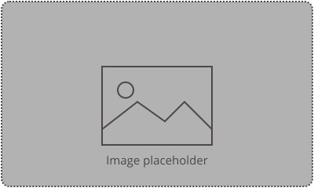

<!-- _class: title -->

# Title of the talk

  
Speaker's name

  
Affiliation

elixir-europe.org

---

## Thanks for using the ELIXIR slide template
These slides facilitate a consistent look and feel to how ELIXIR presents internally and externally.

- ELIXIR theme colour, font (Open Sans) and font size for the slides are pre-set
- Please avoid moving the placement of Heading and Content text boxes. If your content doesn’t fit in the text box, please try to minimise it or break into two slides.

---

## Heading

- First-level bullet — recommended font/size: Open Sans, 22pt
  - Second-level bullet — 20pt
- Use **bold** or orange highlight to emphasise text
- Keep to one idea per slide; split into two slides if content overflows

---

<!-- _class: divider -->

## Divider slide –  this slide can be used as a signpost to divide topics in a talk

---

## Table example

| Header 1 | Header 2 | Header 3 | Header 4 |
|----------|----------|----------|----------|
| text     |          |          |          |
| text     |          |          |          |

---

## Slide with an image

 

Keep photos/images to the inner portion of the slide to ensure the visibility of the ELIXIR logo on the bottom right

---

<!-- _class: no-logo -->

## Heading

- For larger photos and images, please use this slide layout without the
  ELIXIR logo on the bottom right

---

<!-- _class: closing -->

# Thank you

elixir-europe.org

  
Follow us on social media

  

    
    @elixir-europe.org
    
    /company/elixir-europe
  

